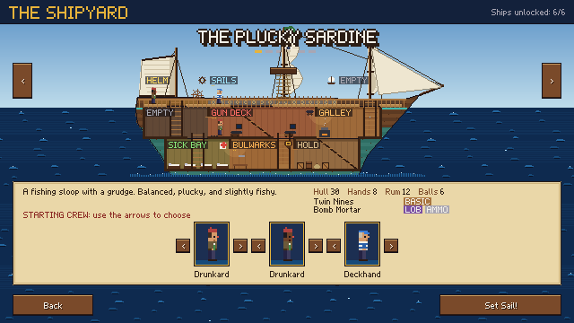
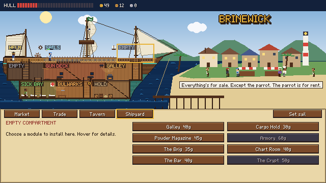

# Slower Than Sardines

*A roguelike naval tactics game about fish, freedom and taxes.*

By Royal Decree, every fish in the sea is Property of His Majesty. Sardines need a licence. Small
sardines need a smaller, more expensive licence. You are the **Free Fishers**: fishermen turned
freedom fighters. Your crew has stolen the plans to **HMS Insufferable**, the Crown's gigantic
flagship and floating tax office. Sail five seas, survive the pirates who infest every one of them,
stay ahead of the pompous **Royal Armada** chasing you (with a brass band), and sink the Insufferable.

It plays like FTL: real-time-with-pause battles, managing power, sending crew around the ship, and
aiming cannons at enemy rooms. Ships are shown **side-on as cutaways**, with decks, ladders and stairs.





## Download & play

Grab the latest build from the **[Releases page](https://github.com/MiserlyExpert/SlowerThanSardines/releases/latest)**:

- **Windows:** download `SlowerThanSardines-Windows.exe` and double-click it. No install, no Python.
  Windows may show "Windows protected your PC" because the game isn't code-signed; click
  **More info → Run anyway**.
- **macOS:** download the macOS zip, unzip, then right-click the app and choose **Open**.
- **Linux:** download the tarball, extract, and run `./SlowerThanSardines`.

## Features

- **Side-view cutaway ships** with a crow's nest, an open top deck and decks below, joined by ladders,
  stairs and rigging. Every room is labelled and colour-coded, and every room does something.
- **Systems and modules.** Helm, Sails, Gun Deck, Bulwarks, Sick Bay and Crow's Nest, plus modules
  you install into empty slots in port: Galley, Cargo Hold, Powder Magazine, Armory (boarding),
  Brig (prisoners), Chart Room, Bar and Crypt. Every room can be upgraded.
- **Hands, not power.** Each sailor brings Hands that you assign to stations. Lose crew and you lose
  their Hands.
- **Broadside battles**, real time with pause. Numbered target markers, warnings on rooms the enemy is
  aiming at, flashes on hits, muzzle flash, recoil and smoke. A sunk enemy cracks in half and goes under.
- **Hazards.** Fire spreads room to room; holes in the hull drain it until patched; a burning powder
  magazine explodes.
- **Boarding.** With an Armory, swing crew from your top deck onto the enemy's and fight down
  through the decks.
- **Island harbors.** Sail into port to buy supplies and cannons, trade goods between ports (prices
  differ everywhere), hire crew at the tavern, and upgrade rooms at the shipyard.
- **Six unlockable ships**, each with its own layout and modules, and a choosable starting crew.
- **15 cannons**, tagged MULTI, FAST, FIRE, HULL, LOB, CREW and RIGGING.
- **A soundtrack** of six tunes chosen by situation, with quiet stretches of waves, gulls, creaking
  timber and bells in between. All art and audio are generated in code.

## Running from source

**Windows, easiest:** install Python from https://www.python.org/downloads/ (tick **"Add python.exe
to PATH"**), then double-click **`Play.bat`** in this folder. The first run takes about a minute to
set things up; after that it starts straight away.

**Any OS, by hand:** requires Python 3.10+.

```bash
pip install -r requirements.txt
python main.py                 # or: python -m sardines
python main.py --unlock-all    # try every ship without earning it
```

Unlocks and lifetime stats are saved to `~/.slower_than_sardines/profile.json`.

## Controls

| Action | Input |
|---|---|
| Pause / resume | **Space** |
| Select cannon, then aim | **1–4** or click a cannon card, then click an enemy room |
| Power / unpower a cannon | Click card / right-click card |
| Add / remove system power | Left / right-click a system column |
| Select crew | Click crew (Shift to add, **A** for all) |
| Move crew | Right-click a room |
| Board (needs Grappling Hooks) | Select crew on your top deck, press **B** |
| Make Sail (escape) | Button, once the escape bar is full (needs a manned helm) |
| Shipwright (upgrades) | **S** on the sea chart |
| Fullscreen / music | **F11** / **M** |

## Building a standalone app

```bash
pip install pyinstaller
pyinstaller --noconfirm --onefile --windowed --name SlowerThanSardines --exclude-module pkg_resources main.py
```

The executable ends up in `dist/`. The GitHub Actions workflow in `.github/workflows/build.yml`
builds it for **Windows, macOS and Linux** on every push to `main`, and attaches the builds to a
GitHub Release when you push a tag like `v0.1.0`.

## Tests

```bash
pip install pytest
SDL_VIDEODRIVER=dummy SDL_AUDIODRIVER=dummy python -m pytest -q
```

The tests simulate battles against every enemy type, test boarding and flooding, generate sea
charts, apply every event outcome, sail a full five-sea run, and render every screen headlessly.

See [DESIGN.md](DESIGN.md) for the full design and code map.
