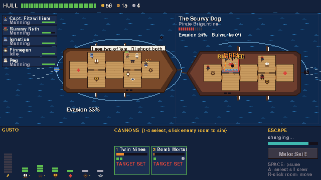
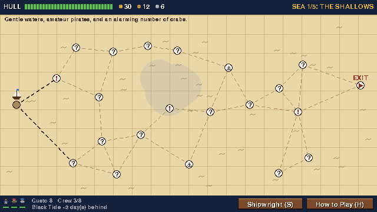

# Slower Than Sardines

*A roguelike naval tactics game about a very important napkin.*

A drunk Royal spy scribbled the location of the pirates' secret base on a bar napkin.
Your crew found it (well — your drunk found it). Sail the **HMS Questionable Decisions** across
five seas and deliver the napkin to the **Royal Armada**, while the **Black Tide** pirate fleet
closes in behind you.

It plays like FTL: Faster Than Light, but at sea and in chunky pixel art. You manage power, aim
cannons at enemy rooms, run crew around to man stations, put out fires, patch leaks and fight off
boarders, all in real time with pause.




## Features

- **Real-time-with-pause ship combat.** Sails, Gun Deck, Bulwarks, Sick Bay, Helm and Crow's Nest.
  Hits damage the hull *and* the system in the room they land in.
- **Fire and flooding.** Fire spreads and burns systems. Leaks flood rooms, slow the ship and
  drown crew, but flooding also puts out fires.
- **Fog banks.** Crossing fog takes two days, so the pirate fleet gains twice as fast. In a foggy
  battle everyone's evasion is halved and escaping is slow.
- **A crew with opinions.** Captains are by far the best at the Helm. The **Drunkard is the best
  gunner and the best brawler on the ship**, but walks like the deck is moving. Also Deckhands,
  Powder Monkeys, Carpenters, Surgeons and Cooks, each of which unlocks its own event options.
- **10 cannons**, from the Long Nine to the Rum Firebomb (a tragic waste of rum).
- **Pirates** with grappling hooks who board you, ghost ships in the fog, a pursuing fleet of
  Black Tide warships, and a final battle against *The Leviathan's Grin*.
- **About 30 hand-written events**, with crew-specific options.
- **No asset files.** All pixel art is defined in code and all audio is synthesized at startup,
  including a chiptune *Drunken Sailor*.

## Running from source

Requires Python 3.10+.

```bash
pip install -r requirements.txt
python main.py          # or: python -m sardines
```

## Controls

| Action | Input |
|---|---|
| Pause / resume | **Space** |
| Select cannon / aim | **1–4** or click a cannon card, then click an enemy room |
| Power a cannon / unpower | Click card / right-click card |
| Add / remove system power | Left / right-click a system column |
| Select crew | Left-click crew (Shift to add, **A** for all) |
| Move crew | Right-click a room on your ship |
| Make Sail (escape) | Button, once the escape bar is full (needs a manned helm) |
| Shipwright (upgrades) | **S** on the sea chart |
| Fullscreen / music | **F11** / **M** |

## Building a standalone app

```bash
pip install pyinstaller
pyinstaller --noconfirm --onefile --windowed --name SlowerThanSardines --exclude-module pkg_resources main.py
```

The executable ends up in `dist/`. The GitHub Actions workflow in `.github/workflows/build.yml`
does this for **Windows, macOS and Linux** on every push to `main`, and attaches the builds to a
GitHub Release when you push a tag like `v0.1.0`.

## Tests

```bash
pip install pytest
SDL_VIDEODRIVER=dummy SDL_AUDIODRIVER=dummy python -m pytest -q
```

The tests simulate battles against every enemy type, generate sea charts, apply every event
outcome, sail a full five-sea run, and render every screen headlessly.

## Project layout

See [DESIGN.md](DESIGN.md) for the full game design and code map.
